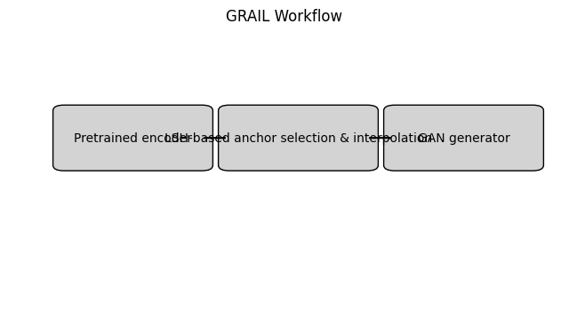

# GRAIL: Generative Reconstruction of Unobserved Dynamics of Single-Cell Transcriptomic Trajectories

This repository contains the code and data supporting the GRAIL framework as described in the accompanying paper. GRAIL reconstructs biologically plausible intermediate cell states between two developmental endpoints using a three-step pipeline: (i) a pretrained autoencoder to embed stage-specific transcriptomes into a latent space, (ii) locality-sensitive hashing (LSH) for anchor selection and smooth interpolation between endpoints in the latent space, and (iii) a generative adversarial network (GAN) decoder to synthesize realistic intermediate expression profiles from the interpolated latent representations.

## Directory Structure

- `src/grail` – Source code for the GRAIL method (to be filled with the actual implementation).
- `data` – Processed single-cell RNA-seq datasets and simulation datasets used in the paper.
- `docs` – Supplementary documentation and tutorials.
- `notebooks` – Jupyter notebooks with example usage and analyses.
- `grail_workflow.png` – Diagram illustrating the GRAIL workflow.

## Installation

To install the dependencies, clone this repository and install the required Python packages:

```bash
git clone https://github.com/sumantaray/GRAIL.git
cd GRAIL
pip install -r requirements.txt
```

## Usage

Please refer to the notebooks in the `notebooks/` directory for examples of training GRAIL on your own data or reproducing the experiments from the paper.

## GRAIL Workflow



## Citation

If you use GRAIL in your research, please cite the associated paper:

> Sumanta Ray, Sukhen Das Mandal, Snehalika Lall, and Saumyadipta Pyne (2026), "Generative Reconstruction of Unobserved Dynamics of Single-Cell Transcriptomic Trajectories".
