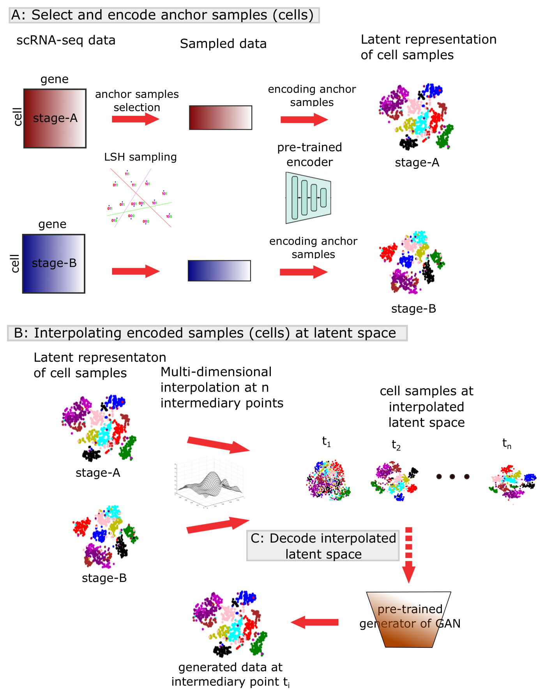

# GRAIL

GRAIL generates candidate intermediate expression profiles from endpoint single-cell observations. The method combines random-hyperplane anchor selection, a shared autoencoder, and an adversarial expression generator. Intermediate populations are held out for evaluation.

[Run the real-data example](quickstart.md) · [Explore the six manuscript figures](results.md) · [Inspect the model](theory.md) · [Read the outputs](api.md)
