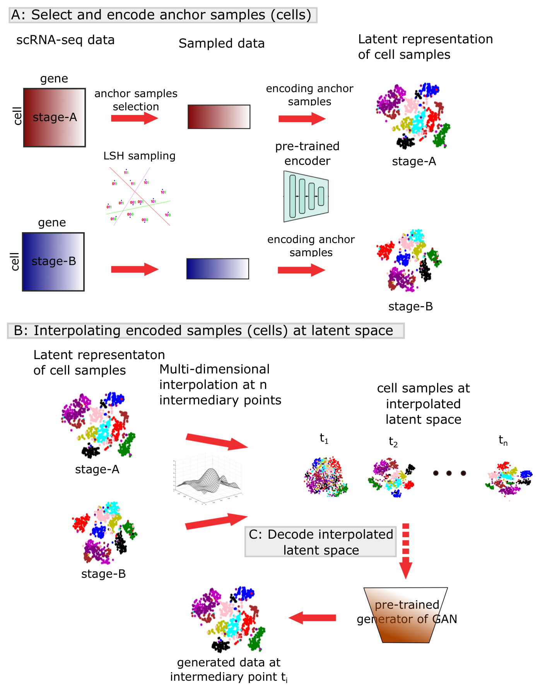
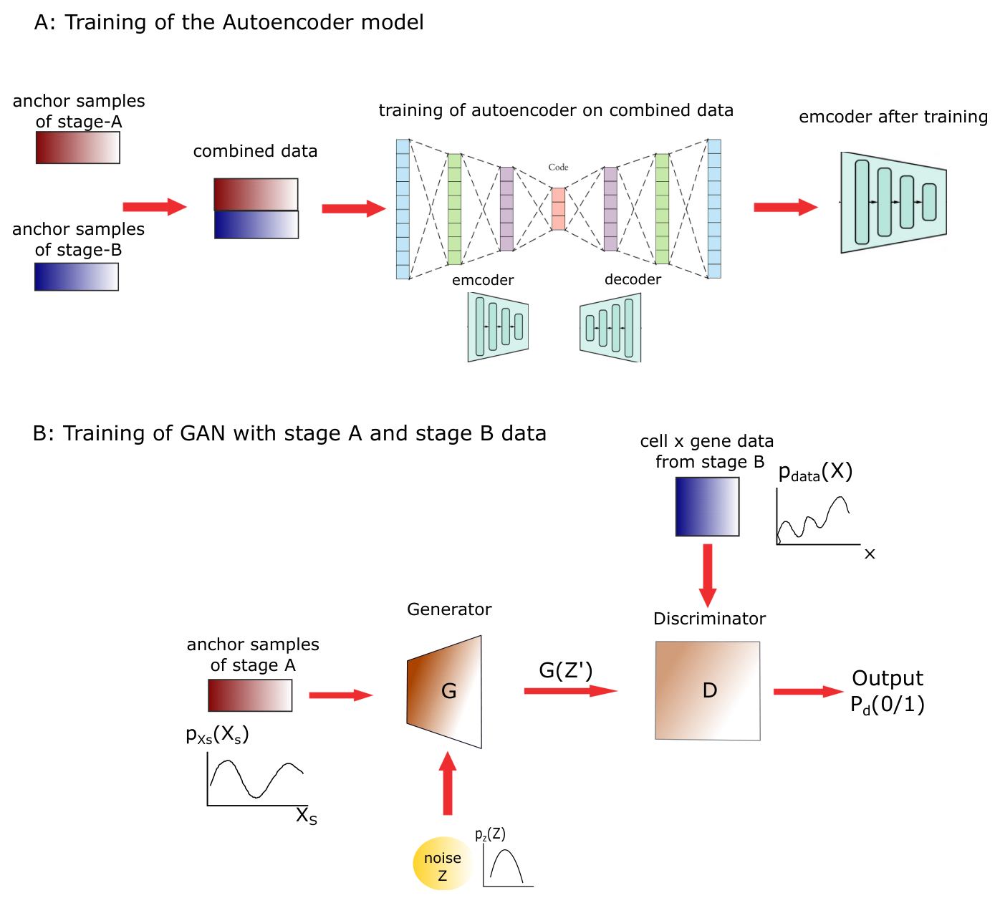
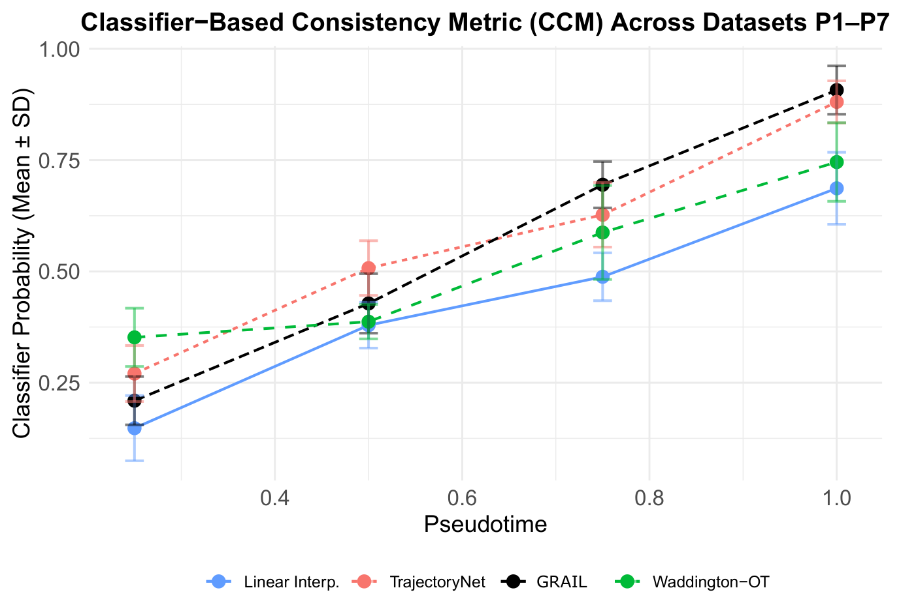
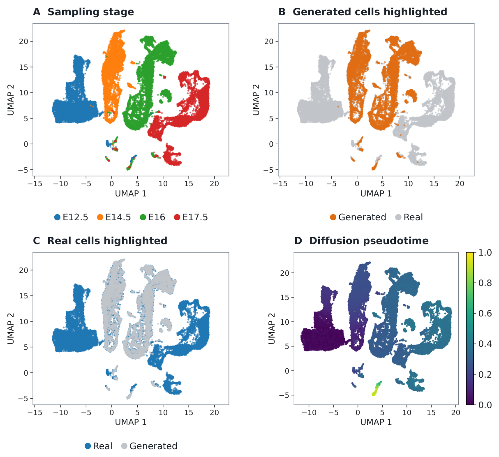
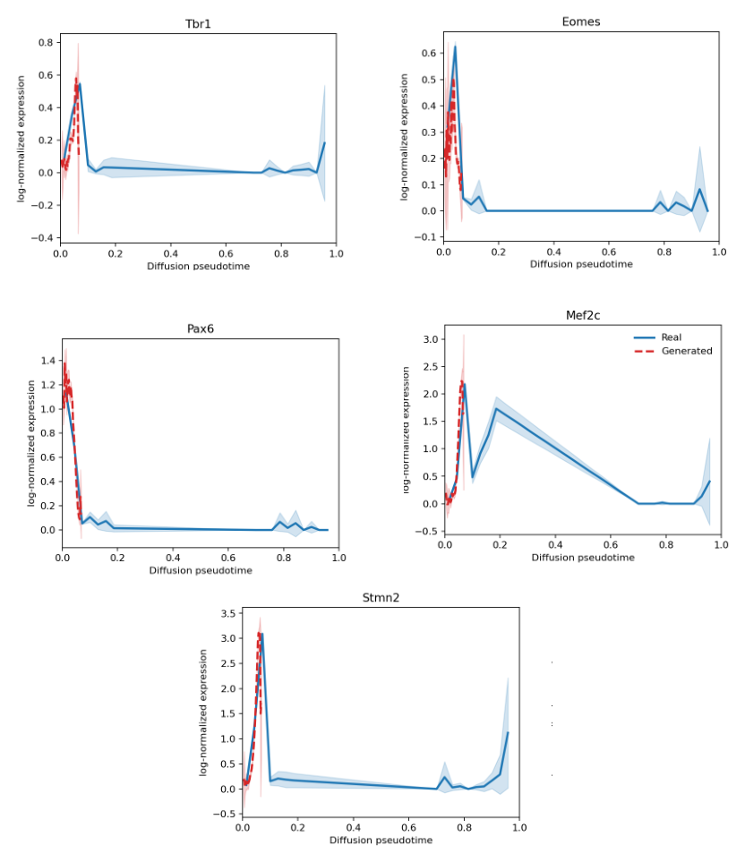
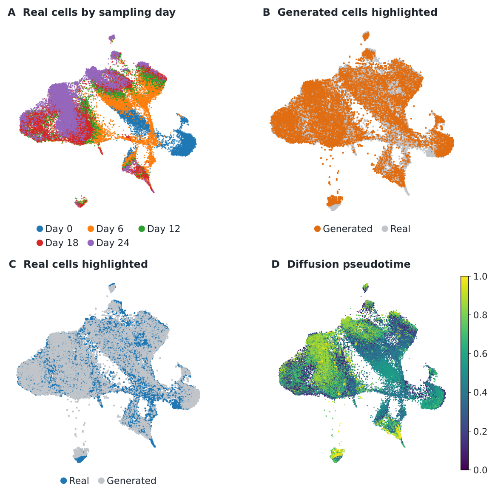

# Figures from the revised manuscript

These six figures were extracted from the supplied second-revision manuscript. The gallery reproduces the supplied artwork. The commands in the [experiment guide](quickstart.md) generate new results from the reference implementation.

### Figure 1. GRAIL workflow

### Figure 2. Network training

### Figure 3. Classifier consistency in simulations

### Figure 4. Mouse cortex

### Figure 5. Marker expression

### Figure 6. Embryoid body

## Interpreting the validation

The manuscript distinguishes endpoint reconstruction by the autoencoder, generator sensitivity to the interpolation coordinate, and agreement with held-out real populations. The DC example measures rank agreement with an endpoint-derived direction. On the worked inputs, fixed weights give 1 for each nonconstant direction and varying weights give 0.6 for the increasing gene. The staged expression and latent-space diagnostics compare against independently observed intermediates. The reference workflow computes values from expression inputs and saves per-seed outputs. The illustrative values in the revision materials are excluded from those outputs.

In the full embryoid-body reference runs, changing the interpolation coordinate changed the generated expression profiles. The real Stage B control was closer to each held-out intermediate population in every seed. The per-seed tables, fitted generator and replay command are in the repository's [measured reference results](https://github.com/sumantaray/GRAIL/tree/main/results).
